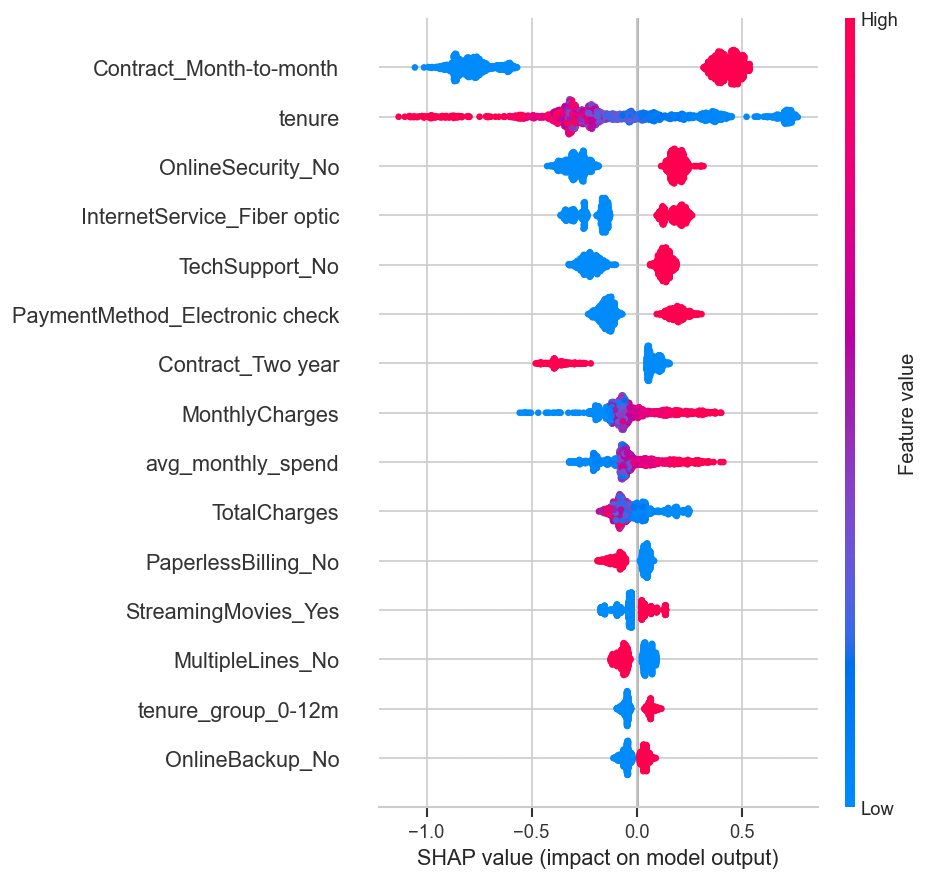
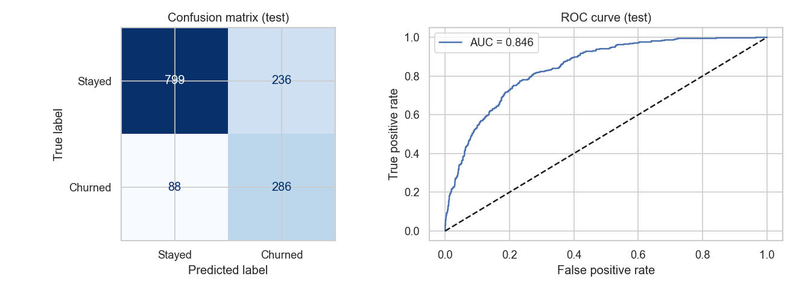

# 📉 Customer Churn Prediction

Predicts which telecom customers are likely to cancel, explains *why*, and serves predictions through a Streamlit web app.

**Live demo:**https://the-churn-predictor.streamlit.app/
## Problem
Acquiring a new customer costs far more than keeping one. Given a customer's profile, contract and services, can we flag who is likely to churn so the business can intervene early?

## Dataset
IBM Telco Customer Churn: 7,043 customers, 20 features, ~26.5% churn (imbalanced).

## Approach
1. **Cleaning**: fixed `TotalCharges` (text → numeric), dropped ID column.
2. **EDA**: churn by contract, tenure, internet service, payment method, charges.
3. **Feature engineering**: `num_services`, `avg_monthly_spend`, `has_support`, `auto_pay`, `tenure_group`.
4. **No data leakage**: train/test split first; all preprocessing lives inside a scikit-learn `Pipeline`.
5. **Imbalance**: class weights / `scale_pos_weight` (no resampling needed).
6. **Models compared** with 5-fold stratified CV: Logistic Regression, Random Forest, XGBoost.
7. **Tuning**: `RandomizedSearchCV` on XGBoost (ROC-AUC).
8. **Threshold selection**: chosen on out-of-fold training predictions (F1), not on the test set.
9. **Explainability**: SHAP summary + bar plots.
10. **Deployment**: Streamlit app with retention suggestions.

## Results (held-out test set)
| Metric | Score |
|---|---|
| ROC-AUC | 0.846 |
| Recall (churners) | 0.78 |
| Precision (churners) | 0.55 |
| F1 (churners) | 0.64 |

Cross-validation showed that tuned tree models and a well-regularised Logistic Regression perform similarly on this dataset (ROC-AUC ≈ 0.84-0.85), a useful reminder that simple baselines are strong on tabular data.

## Key insights
- Month-to-month contracts and the first year of tenure carry the highest churn.
- Fiber-optic customers, high monthly charges and electronic-check payers churn more.
- Tech support / online security and longer contracts are protective.

_(See the notebook's SHAP plots for the model-level view.)_

## Screenshots



## Run locally
```bash
git clone https://github.com/<your-username>/churn-prediction.git
cd churn-prediction
python -m venv .venv && source .venv/bin/activate   # Windows: .venv\Scripts\activate
pip install -r requirements.txt

jupyter notebook churn_prediction.ipynb   # re-train and regenerate model/ and images/
streamlit run app.py                      # launch the app
```

## Project structure
```
├── churn_prediction.ipynb   # full analysis & modelling
├── features.py              # feature engineering shared by notebook and app
├── app.py                   # Streamlit app
├── data/                    # dataset
├── model/                   # saved pipeline + metadata (threshold, metrics)
├── images/                  # charts used in README
└── requirements.txt
```

## Tech stack
Python · pandas · scikit-learn · XGBoost · SHAP · Streamlit · Git
